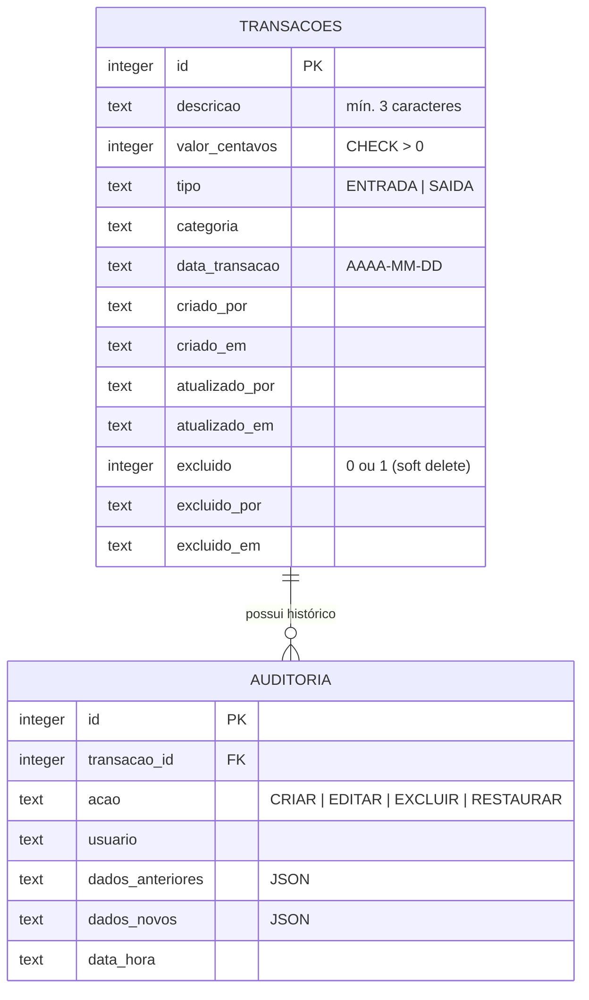

# Modelagem do Banco de Dados

Banco relacional (SQLite). O DDL completo está em `backend/src/db.js`.

## Diagrama Entidade-Relacionamento

## Decisões de modelagem

| Decisão | Motivo |
|---|---|
| `valor_centavos` como **inteiro** | Evita erros de arredondamento de ponto flutuante (ex.: `0.1 + 0.2`). A API converte reais ⇄ centavos. |
| Valor **sempre positivo** + campo `tipo` | O sinal vem do tipo; `CHECK (valor_centavos > 0)` impede valores negativos mesmo fora da API. |
| `excluido` + `excluido_por/em` | **Soft delete**: o registro permanece para rastreabilidade (H1). |
| Trigger `trg_transacoes_bloqueia_delete` | Torna a exclusão física **impossível**, mesmo via SQL direto. |
| Tabela `auditoria` append-only | Triggers bloqueiam `UPDATE`/`DELETE`: trilha confiável e imutável. |
| Índice único parcial `ux_transacoes_duplicidade` | Impede duplicidade (problema do sistema legado) apenas entre registros **ativos**, permitindo reaproveitar a combinação após exclusão. |
| Datas em ISO 8601 (UTC) | Padrão, ordenável como texto e independente de fuso. |

## Rastreabilidade: quem e quando

| Pergunta | Colunas |
|---|---|
| Quem criou e quando? | `criado_por`, `criado_em` |
| Quem alterou por último e quando? | `atualizado_por`, `atualizado_em` |
| Quem excluiu e quando? | `excluido_por`, `excluido_em` |
| O que mudou, exatamente? | `auditoria.dados_anteriores` × `dados_novos` |
